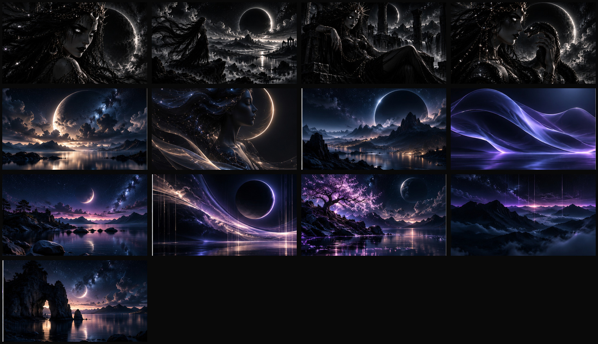

# Nyx wallpapers

Wallpapers for the Nyx themes, at 3840 × 2160. They live here rather than in
nyx-design so the apps that pin nyx-design, and every nyx-packages build, don't
download them.

[wallpapers.toml](wallpapers.toml) says which belong to which theme, which one a new
install shows on the desktop (`default`) and which on the lock and login screens
(`lock`). NyxOS packages this repository and puts the files in
`share/backgrounds/nyx/`; the theme service picks the theme's defaults.

Every theme's defaults are the NyxOS wordmark in its colours: NYXOS centred on the
desktop (Nyx Plymouth ends the boot on the same picture) and N, Y and X stacked on the
right of the lock screen, clear of the clock and the sign-in card.
`tools/wordmark.py` draws them from nyx-design's built-in themes, and the marks alone
are in [wordmark/](wordmark).

| Theme | Sets |
| --- | --- |
| Every theme | wordmark (desktop, lock) |
| Nyx Dark | wordmark, monochrome (4), celestial (9) |

## License

The images are dedicated to the public domain under [CC0 1.0](LICENSE). The NyxOS name
and wordmark are the project's marks; CC0 doesn't grant rights to use them to name
or brand something else.
